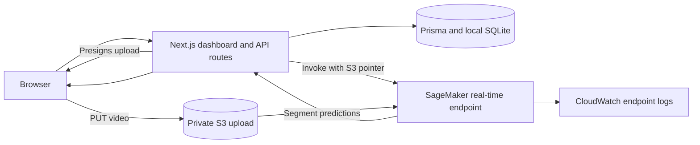
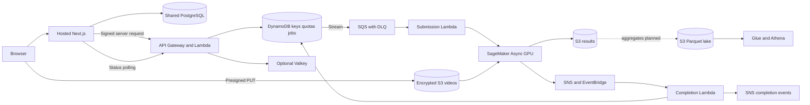

# Aspect Sentiment architecture

## Verified serving path

Guarded uploads now use the optional async route by default. The synchronous path below remains a private demo option with REQUIRE_MODERATION=0. See the [guardrail architecture and release steps](SAFETY_AND_MODEL_QUALITY.md).

This path passed a live browser test before the real-time GPU endpoint was removed to stop idle charges. The [hosting guide](HOSTING.md#restore-the-real-time-demo) records how to restore it.

| Layer | Implementation |
| --- | --- |
| Frontend | Next.js App Router, React, and Tailwind. Signup, sign-in, dashboard, upload progress, video summary, and per-segment results. |
| Identity and API | Auth.js credentials with bcrypt and JWT sessions. The local SQLite schema stores users, API quotas, and upload ownership. API keys protect upload and inference requests. Hosted authentication, key storage, and rate limits need hardening before public registration. |
| Upload and inference | `POST /api/upload-url` issues a presigned PUT and records the upload owner. `POST /api/sentiment-inference` validates ownership and quota, invokes SageMaker with an S3 URI, and validates the response. |
| Model | PyTorch with R3D-18 video features, mel audio features, and BERT text features. The inference handler extracts audio with FFmpeg and uses Whisper for speech segmentation. Fusion produces seven emotion classes and three sentiment classes. |
| Training | MELD training, validation, and test splits in S3. SageMaker GPU training saves the best validation checkpoint and emits TensorBoard data. The original logged test metrics came from the final in-memory epoch and should be distinguished from evaluation of the deployed checkpoint. |
| Operational data | AWS project **console dot dream**, selected Region `ap-southeast-2`. S3 holds datasets and model archives. SageMaker endpoint configuration identifies the model and runtime. Endpoint compute can be removed between demos while preserving those dependencies. |

## Target hosted and async architecture

The optional CDK extension defines Aurora PostgreSQL Serverless v2 with a writer, failover reader, and TLS RDS Proxy. The PostgreSQL migration covers organizations, memberships, plans, subscriptions, invoices, and audit logs, with forced row-level security for the app role. DynamoDB is the authoritative quota and job store for async requests. The quota reservation and job insertion share a transaction. Valkey handles rate limits and a quota pre-check, with DynamoDB fallback. VPC endpoints serve isolated workloads, and separate KMS keys cover data classes.

The async GPU can scale from zero to one instance for low-volume staging. A queued request wakes capacity, and cold-start time must be measured. The Next.js async API proxy exists locally. Dashboard integration, key issuance, the hosted PostgreSQL transition, and direct user notification delivery are still pending. Aurora and Valkey are optional production components and do not need to run for a public preview using managed PostgreSQL and the current web app.

## Telemetry and data lifecycle

- The model handler can emit structured CloudWatch EMF with endpoint, version, and class as metric dimensions. Request and pseudonymous user identifiers belong in the event body. Video, transcripts, API keys, and email addresses should stay out of logs.
- The monitoring stack defines capture, Firehose delivery, Athena queries, hourly drift and accuracy jobs, CloudWatch alarms, dashboards, and a MELD baseline builder. Deploy and verify these against the running model before relying on alerts.
- The optional data extension adds a tenant/date Parquet layout and Glue catalog. The aggregate and capture publishers still need to be wired. Review access controls and test erasure and backup restores before collecting production data.
- Capacity planning uses one million inference requests per day as a scenario. Measure clip lengths, peak arrival rate, queue age, GPU throughput, and cost per successful prediction before sizing production.

See the [detailed data architecture](ai-video-sentiment-model-main/monitoring/DATA_ARCHITECTURE.md), [verification status](ai-video-sentiment-model-main/monitoring/TEST_STATUS.md), and [hosting guide](HOSTING.md).
