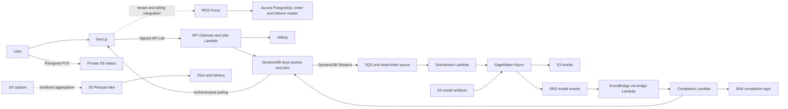

# Aspect Sentiment data architecture

This extension lives in the existing Python CDK monitoring stack in Sydney. Enable it with `ENABLE_DATA_ARCHITECTURE=1`. SQLite and the existing synchronous endpoint remain available for the local demo.

## Data model and retention

The PostgreSQL [migration](sql/001_tenants.sql) creates a separate `aspect_app` role with forced row-level security. For each request, trusted backend code must authenticate the user and set `aspect.user_id` and `aspect.tenant_id` with parameterized `set_config(..., true)` calls in the same transaction as all queries. The role can read its own user and membership, the active organization and its tenant rows, and the shared plan catalog. Only a separate privileged provisioning identity can change memberships, billing state, or audit records. Transaction-local settings are required with pooled connections.

| PostgreSQL table | Key and access | Retention policy |
| --- | --- | --- |
| Users | User UUID and unique normalized email | Active lifetime, then erase after verified request |
| Organizations | Tenant UUID | Active lifetime, then 30 days for closure processing |
| Memberships | Tenant and user UUID, reverse lookup by user | Until removed or the user is erased |
| Plans | Plan identifier | Keep plans referenced by billing records |
| Subscriptions | Tenant UUID and plan foreign key | Active lifetime plus 24 months |
| Invoices | Tenant UUID and invoice UUID | Seven-year planning assumption, confirm against the applicable accounting obligations |
| Audit log | Tenant UUID and monotonic event ID | 365 days, null the actor on erasure |

Retention entries for PostgreSQL are policies for the operator. Automated SQL purging and a hosted identity/billing integration are pending. Keep email in the identity store and omit it from log and event payloads.

| DynamoDB table | Primary key and indexes | Access and retention |
| --- | --- | --- |
| API keys | PK `key_hash`, GSI `ByUser(user_id,key_hash)` | SHA-256 lookup of an opaque random token and user revocation. Set an expiry at issuance, rotate regularly, and reject expired keys before TTL sweeps them. |
| Quota counters | PK `tenant_id`, SK `period` | Calendar month in UTC. Conditional atomic reservation and job insertion use a single DynamoDB transaction. Expire after 93 days. Fallback minute counters expire after three minutes. |
| Inference jobs | PK `tenant_id`, SK `job_id`. GSIs `ByJob(job_id)` and `ByUser(user_id,job_id)`. | Tenant-scoped status, reverse completion lookup, erasure lookup. Store request/result S3 pointers and status. Job expires after 30 days. |

DynamoDB is on-demand with point-in-time recovery. The Valkey TLS cache uses tenant-scoped minute counters and a 15-second exhausted-quota pre-check. DynamoDB enforces the monthly cap and backs the rate limiter during a cache outage. Switching between stores can reset the effective count within that minute. Per-tenant rate targets must be set from the plan and tested with a noisy tenant.

S3 stores uploads and request manifests for seven days, capture for seven days, inference results for 30 days, and lake aggregates for 365 days. Model artifacts remain versioned for release rollback. Versioned data buckets expire noncurrent versions after seven days. Private bucket access, TLS and separate KMS keys apply per data class.

## Rollout

1. Confirm Sydney in AWS Settings → View all projects → Overview → Additional Info → Region. Check billing and service quotas before adding a second GPU endpoint or Multi-AZ database. Supply the existing stack variables plus `APP_ORIGIN`, `ASYNC_MODEL_ARTIFACT_KEY`, and `ASYNC_MODEL_IMAGE_URI`. Use a versioned model key and an image digest. The default Aurora PostgreSQL version is 16.15 and can be set with `AURORA_POSTGRES_VERSION`. Recheck that the chosen version is orderable for `db.serverless` before deployment. In the current project, set `ASYNC_MAX_INSTANCES=1` for staging because the real-time endpoint consumes one of the two available `ml.g5.xlarge` endpoint instances.
2. Deploy the extension with `CREATE_ASYNC_ENDPOINT` unset. Stage the trained artifact with the updated inference handler into the generated artifacts bucket. From the data VPC, apply the SQL migration using the database admin identity, set the new application role password from its generated secret through a trusted migration client, and test both rotation schedules and RDS Proxy TLS. Verify the writer and reader land in different Availability Zones.
3. Set `CREATE_ASYNC_ENDPOINT=1` and deploy again. Verify AWS availability of the instance and engine version. For staging, run a short inference through both success and failure paths. The async result listener uses SageMaker SNS notifications with explicit inference ID and output location, then forwards a minimal event through EventBridge. Completion notifications are opaque SNS events. The user sees terminal status via authenticated polling. Direct email or browser push needs a subscriber.
4. Configure `AWS_JOBS_API_URL` on Next.js and grant the app role the stack’s signed API routes. The async routes use `X-Aspect-Api-Key` upstream. Seed a high-entropy test key digest in DynamoDB with `tenant_id`, `user_id`, `monthly_limit`, `rate_per_minute`, and `expires_at`. The existing SQLite-issued keys and dashboard have not been migrated. Call upload signing, PUT the MP4 with the returned headers, POST the upload ID to the jobs route, then poll by job ID.
5. Run the saved view definitions in the Athena operations workgroup. Parquet paths are `<dataset>/dt=YYYY-MM-DD/tenant_id=<opaque-id>/`. Athena partition projection requires an explicit tenant equality filter. Give analyst identities approved data access. Workgroup limits control spend and do not enforce tenant authorization. A scheduled publisher for usage, accuracy, and drift aggregates, plus the capture producer for the new capture bucket, remain pending. Publish only tenant aggregates with minimum cohort sizes before opening analytics access.

## User deletion and retention

Verify identity and any legal hold outside the app. Revoke keys, stop new submissions, and drain in-flight jobs. Run [erase_subject.py](runtime/erase_subject.py) with an operator credential restricted to the specified tables and buckets. Repeat the GSI checks after propagation. For a revoked user, allow the ten-minute presigned upload window to close before the final S3 sweep.

In one PostgreSQL transaction, delete memberships and the user row, allow the audit actor foreign key to clear, and retain tenant billing records required for accounting. Preserve shared quota counts and financial aggregates. If a legacy account exists, remove its SQLite rows, old upload versions and attributable captures as well. Purge any historical lake files containing that user’s contribution by rewriting the affected partition, or retain only irreversibly aggregated tenant metrics. The new lake schema excludes user identifiers. Model artifacts contain model weights and reference training material, with no application uploads. Cache entries expire automatically and contain tenant counters only.

Keep the deletion receipt in an access-controlled compliance ledger. Preserve the receipt for at least the longest backup lifetime. When restoring backups, replay the deletion ledger before granting application access. The provided script covers DynamoDB and the new versioned video and result buckets. Database, legacy and lake steps are operator-run. Immutable backups expire according to their retention schedule.

## Recovery and capacity

| Incident | Recovery steps | Initial objective |
| --- | --- | --- |
| Aurora writer/AZ failure | Confirm proxy health and writer election, retry interrupted transactions with idempotency identifiers | RPO 0 for committed transactions, RTO 15 minutes |
| Accidental database deletion | Restore Aurora PITR to an isolated cluster, apply erasure ledger, test RLS and proxy routing, then cut over | RPO 5 minutes, RTO 4 hours |
| DynamoDB accidental writes | Restore each affected table to a new name, reconcile quota and in-flight jobs, replay erasures, rewire stream and consumers | RPO 5 minutes, RTO 4 hours |
| S3 accidental delete | Restore previous versions and verify hashes, repoint the affected job if required | RPO one object version, RTO 4 hours |
| Regional loss | Record an outage and recover from regional services when restored. The current project is single-Region. | No cross-Region RPO or RTO commitment |

### Async recovery

Inspect queue age and the DLQ. Check for an existing terminal job and result before redrive. The worker leases submissions and retries after the lease, but a network timeout after SageMaker accepts a request can still produce duplicate GPU work. Completion updates are conditional and the user notification consumer must tolerate repeated SNS events. Treat ambiguous invocations and jobs stuck in `RUNNING` as reconciliation cases. Use the recorded S3 pointers, then requeue only after confirming no terminal output. Revoke and reconcile expired jobs before their DynamoDB TTL removes the pointers.

### One million requests per day

Use 30 million requests per 30-day month and 11.6 requests per second average. Test at average and 5× burst rates with realistic upload sizes, clip lengths, tenant skew, slow uploads, duplicate submissions, cache loss, Aurora failover, and a SageMaker outage. Measure GPU throughput and GPU memory, API p95, queue age, completion p95, quota accuracy, and cost per successful video. Provisional targets are API p95 below 500 ms excluding the upload itself, zero cross-tenant accesses, zero duplicate quota charges, and a completion target agreed after benchmarking. The endpoint starts with one GPU and defaults to backlog-based scaling between zero and one GPU. Verify wake-from-zero and cold-start latency in staging. Set the bounds from measured throughput and project quotas before load testing at target volume.

### Monthly cost model in USD

These are budget placeholders to replace with Sydney quotes and load-test results. At an illustrative 10 MB per video, seven days of input retention holds about 70 TB. At 0.25 jobs per GPU-second, average demand requires about 47 GPUs before headroom.

| Component | Monthly planning estimate or formula |
| --- | --- |
| SageMaker async | 34,300 GPU-hours × Sydney instance rate. At an illustrative US$2/hour, about US$68,600. |
| Aurora and proxy | Two continuously running instances at one average ACU each yield about 1,460 ACU-hours. Add proxy capacity charges, storage, I/O, and backup overage. Budget US$400–800 pending usage and quote. |
| DynamoDB | Approximately 270M writes and 120M reads under an illustrative nine writes and four reads per job. Budget US$250–700 including index and transactional overhead and PITR. |
| Valkey | Meter average stored GB and request processing units. Budget US$30–150 with fallback capacity in DynamoDB. |
| S3 | About 70 TB steady-state raw video plus result storage, capture, lake data, and request costs. At an illustrative US$0.025/GB-month, raw storage alone is about US$1,750. |
| API Gateway, Lambda, SQS, SNS, EventBridge | Budget US$300–1,000 for submission, polling, queueing, and completion. Polling frequency materially affects this line. |
| KMS, Secrets Manager and VPC endpoints | Budget US$60–250, including endpoint hours in two AZs, request charges, and secrets. |
| Glue and Athena | Budget US$30–200 with partition pruning and scan caps. Include publisher/compaction compute when implemented. |
| Existing monitoring and web tier | Add the existing [monitoring estimate](COST.md) and budget US$100–400 for the hosted app and load balancer. |

AWS pricing references [SageMaker](https://aws.amazon.com/sagemaker/ai/pricing/) · [Aurora](https://aws.amazon.com/rds/aurora/pricing/) · [DynamoDB](https://aws.amazon.com/dynamodb/pricing/on-demand/) · [ElastiCache](https://aws.amazon.com/elasticache/pricing/) · [S3](https://aws.amazon.com/s3/pricing/) · [Athena](https://aws.amazon.com/athena/pricing/)
